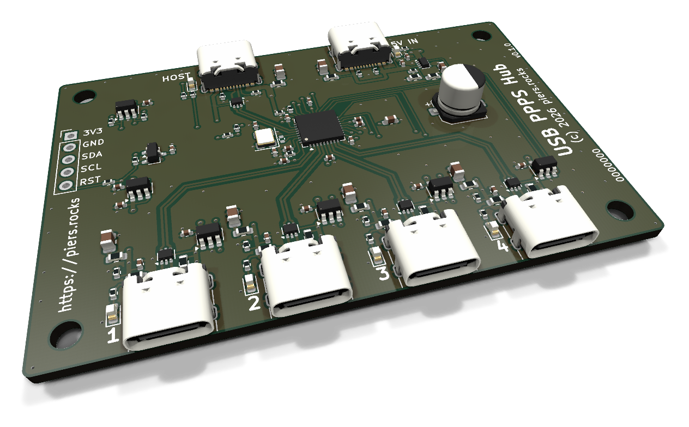

# USB PPPS Hub

A 4-port USB 2.0 hub with USB-C connectors and per-port power switching (PPPS). Linux and macOS hosts can turn each port's power on and off independently with [uhubctl](https://github.com/mvp/uhubctl). Supports bus or external power.



## Files

Download the fab files, EEPROM image, KiCad project and schematic PDF from [Releases](../../releases) or generate them with `scripts/generate.sh`.

## Ordering

To have JLCPCB make and assemble the board, upload the gerbers `usb-ppps-hub-gerbers.zip` and choose:

- 4 layers, 1.6 mm thick
- layer stackup JLC04161H-7628
- PCB assembly, top side only, economic or standard

Upload the BOM `usb-ppps-hub-bom.csv` and CPL `usb-ppps-hub-cpl.csv`, and check the parts' positions in JLC's preview before you place the order.

## Programming the EEPROM

The hub's EEPROM must be programmed with `usb-ppps-hub-eeprom.bin` before the hub will operate.

These instructions explain how to use a Raspberry Pi Pico or Pico 2 to program it.

1. Install [picotool](https://github.com/raspberrypi/picotool) 2.1.1 or later and Python 3.

2. Solder or press a 1x4 pin header into GND, SDA, SCL and RST and wire it to the Pico:

   | Header | Pico |
   | --- | --- |
   | GND | Pin 8 (GND) |
   | SDA | Pin 6 (GP4) |
   | SCL | Pin 7 (GP5) |
   | RST | Pin 9 (GP6) |

3. Download `usb-ppps-hub-eeprom.bin` and `usb-ppps-hub-programmer.zip` from [Releases](../../releases) into the same folder as each other and unzip `usb-ppps-hub-programmer.zip`.

4. Power the board by plugging HOST into a powered USB port.

5. Hold BOOTSEL on the Pico while you connect it to your computer. In the folder you downloaded the files from step 3 to, run:

   ```bash
   python3 programmer/program.py usb-ppps-hub-eeprom.bin
   ```

   This programs the hub with a randomly generated, highly likely to be unique, serial number.

   On success it should output `Programmed and verified`.

6. To check the hub works, install [uhubctl](https://github.com/mvp/uhubctl) and run `sudo uhubctl`. It should list the hub as `[1209:f543 piers.rocks USB PPPS Hub <serial number>, USB 2.00, 4 ports, ppps]`.

## Using the hub

Plug the host into the HOST port and devices into ports 1 to 4.

The hub will run either being powered by the host, or from an external 3A supply if you plug one into 5V IN. On external power the hub can supply up to 2A across all ports. Plugging or unplugging an external supply causes the hub to briefly disconnect, turn its ports off and reconnect.

Only plug USB devices into ports 1 to 4, not USB hosts.

## Using [uhubctl](https://github.com/mvp/uhubctl)

`sudo uhubctl` lists the hubs it can control and their locations. To turn port 2 off:

```bash
sudo uhubctl -l <location> -p 2 -a off
```

Use `-a on` to turn it back on.

## Design

[Schematic (PDF)](../../releases/latest/download/usb-ppps-hub-schematic.pdf)

## Developing

All KiCad and fab files are auto-generated from scripts and configuration.

To modify or extend this design start with [DEVELOPMENT.md](DEVELOPMENT.md).

## License

(c) 2026 piers.rocks.

Licensed under the [CERN Open Hardware Licence Version 2 - Weakly Reciprocal](LICENSE) (CERN-OHL-W-2.0).

Boards made from this design must display https://piers.rocks, as set out in [NOTICE](NOTICE).
