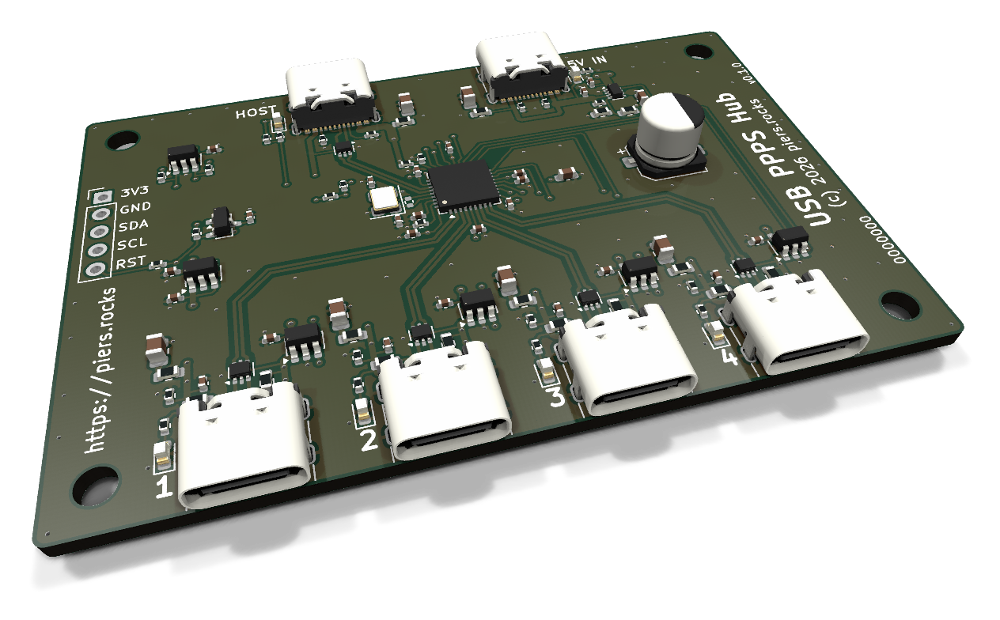

# USB PPPS Hub

A 4-port USB 2.0 hub with USB-C connectors and per-port power switching (PPPS). Linux and macOS hosts can turn each port's power on and off independently with [uhubctl](https://github.com/mvp/uhubctl). Supports bus or external power.



<em>Currently untested - order at your own risk.</em>

## Files

Download the fab files, EEPROM image, KiCad project and schematic PDF from [Releases](../../releases) or generate them with `scripts/generate.sh`.

## Ordering

To have JLCPCB make and assemble the board, upload the gerbers `usb-ppps-hub-gerbers.zip` and choose:

- 4 layers, 1.6 mm thick
- layer stackup JLC04161H-7628
- PCB assembly, top side only, economic or standard

Upload the BOM `usb-ppps-hub-bom.csv` and CPL `usb-ppps-hub-cpl.csv`, and check the parts' positions in JLC's preview before you place the order.

## Programming the EEPROM

The EEPROM on board must be programmed with `usb-ppps-hub-eeprom.bin` before the hub will operate.

### Programming with a Raspberry Pi

You can use a Raspberry Pi with I²C enabled (`sudo raspi-config nonint do_i2c 0`).

Solder or press a 1x5 pin header into the holes labelled 3V3 to RST on the left edge and wire it to the Pi:

| Header | Pi |
| --- | --- |
| 3V3 | Not connected |
| GND | Pin 6 (GND) |
| SDA | Pin 3 (GPIO2) |
| SCL | Pin 5 (GPIO3) |
| RST | Pin 9 (GND) |

Power the board by plugging HOST into one of the Pi's USB ports and write the image:

```bash
sudo modprobe at24
echo 24c02 0x50 | sudo tee /sys/bus/i2c/devices/i2c-1/new_device
sudo dd if=usb-ppps-hub-eeprom.bin of=/sys/bus/i2c/devices/1-0050/eeprom
sudo cmp usb-ppps-hub-eeprom.bin /sys/bus/i2c/devices/1-0050/eeprom
echo 0x50 | sudo tee /sys/bus/i2c/devices/i2c-1/delete_device
```

`cmp` should print nothing if the EEPROM matches the image programmed.


Disconnect the header and the hub should boot. You can check this on the Pi with `sudo lsusb -v -d 0424:2514` which should display `Per-port power switching`.

## Using the hub

Plug the host into the HOST port and devices into ports 1 to 4.

The hub will run either being powered by the host, or from an external 3A supply if you plug one into 5V IN. On external power the hub can supply up to 2A across all ports. Plugging or unplugging an external supply causes the hub to briefly disconnect, turn its ports off and reconnect.

Only plug USB devices into ports 1 to 4, not USB hosts.

## Using [uhubctl](https://github.com/mvp/uhubctl)

`sudo uhubctl` lists the hubs it can control and their locations. To turn port 2 off:

```bash
sudo uhubctl -l <location> -p 2 -a off
```

Use `-a on` to turn it back on.

## Design

[Schematic (PDF)](../../releases/latest/download/usb-ppps-hub-schematic.pdf)

## Developing

All KiCad and fab files are auto-generated from scripts and configuration.

To modify or extend this design start with [DEVELOPMENT.md](DEVELOPMENT.md).

## License

(c) 2026 piers.rocks.

Licensed under the [CERN Open Hardware Licence Version 2 - Weakly Reciprocal](LICENSE) (CERN-OHL-W-2.0).

Boards made from this design must display https://piers.rocks, as set out in [NOTICE](NOTICE).
